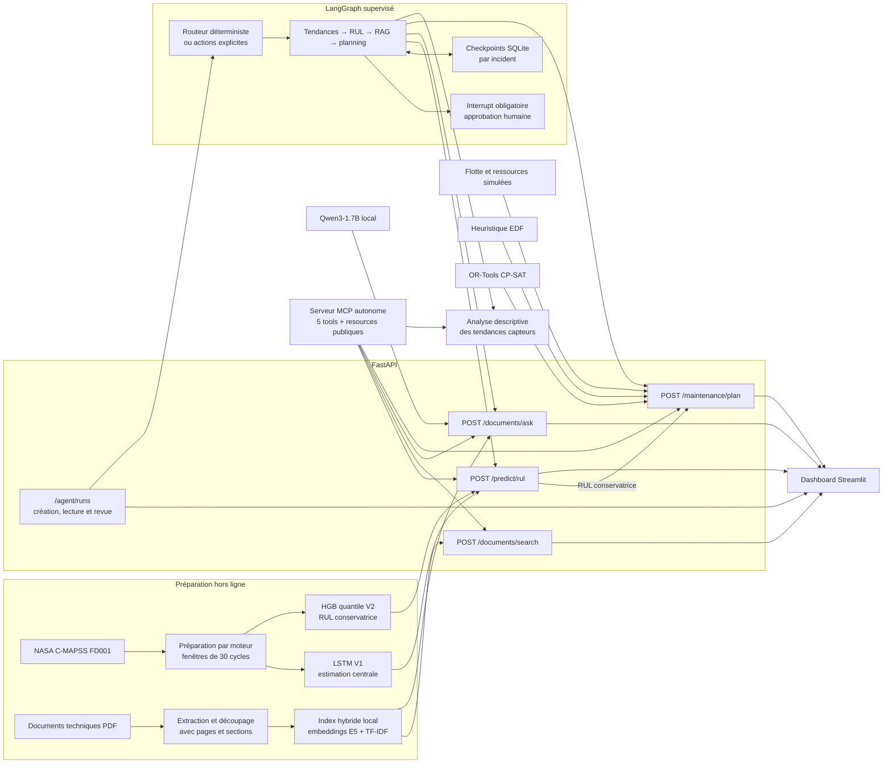

# Architecture de la plateforme

Cette architecture sépare l'entraînement, les services métier, l'orchestration et l'interface. Les modèles et les index sont construits hors ligne, puis chargés une seule fois par les services d'exécution. Streamlit ne contient aucune logique de modèle : il consomme uniquement les routes HTTP. Le workflow agentique réutilise les mêmes services injectés ; il ne réimplémente ni la prédiction, ni le RAG, ni la planification.

## Chaîne RUL

Le pipeline transforme chaque historique moteur en une fenêtre multivariée de 30 cycles et 15 capteurs. Le LSTM V1 fournit une estimation centrale. Le HistGradientBoosting quantile V2 fournit une valeur volontairement prudente, calibrée avec une marge de sécurité. Les deux sorties viennent de modèles indépendants et ne forment pas un intervalle de confiance.

Les artefacts sérialisés contiennent le prétraitement, l'ordre des capteurs, les modèles et leurs empreintes. L'API vérifie ces éléments au démarrage et n'entraîne aucun modèle pendant une requête.

## Chaîne documentaire

Les documents sont extraits avec leurs métadonnées de provenance, puis découpés en passages. La recherche combine similarité dense et TF-IDF. Le générateur local reçoit uniquement les passages récupérés, produit des références vérifiables et s'abstient lorsque les preuves sont insuffisantes.

## Chaîne de planification

La RUL conservatrice devient l'échéance d'un équipement dans un scénario simulé. Le planificateur applique les capacités de l'atelier et des techniciens, puis compare une heuristique par échéance à CP-SAT. L'échéance porte sur la fin de l'intervention. Le coût agrège maintenance préventive, immobilisation, avance et retard pondéré par la criticité.

Les durées, ressources, criticités et coûts ne proviennent pas de C-MAPSS. Ils sont explicitement fournis par les scénarios afin de ne pas confondre démonstration d'optimisation et résultat économique industriel.

## Orchestration agentique supervisée

Le workflow LangGraph reçoit un incident, un historique moteur éventuel, une question documentaire éventuelle et, si nécessaire, un contexte de planification. Il produit un état strictement structuré et sérialisable. Son ordre d'exécution est déterministe : analyse descriptive des tendances, prédiction RUL, réponse documentaire, puis planification. Si une planification est demandée, la prédiction RUL est ajoutée automatiquement et seule la `decision_value`, égale à la RUL conservatrice, peut alimenter le planificateur.

Le routeur actuel est une référence déterministe par mots-clés. L'appelant peut aussi fournir explicitement `requested_actions`. Qwen3-1.7B demeure le générateur de réponses documentaires ; il ne choisit pas les outils et ne pilote pas le workflow. Cette séparation rend les routes testables et évite de présenter une décision heuristique comme un raisonnement autonome.

Chaque incident utilise son identifiant comme fil de checkpoint. Les états sont persistés dans SQLite, avec un sérialiseur restreint, ce qui permet de consulter ou de reprendre un workflow après redémarrage. Avant toute recommandation finale, LangGraph produit un `interrupt` : une personne doit approuver, modifier ou rejeter le brouillon. Les erreurs métier sont retournées sous forme structurée et seuls les échecs explicitement transitoires font l'objet de nouvelles tentatives.

Le runtime refuse de relancer un identifiant déjà en attente de revue, afin de ne pas effacer silencieusement une décision humaine pendante. Un incident terminé ou échoué peut en revanche être recalculé : le nœud initial remet à zéro les anciennes sorties avant d'exécuter la nouvelle demande. Le fichier de checkpoint est configuré dans `configs/agent.toml`; Compose le place dans le volume nommé `agent-checkpoints`.

L'analyse des capteurs mesure des variations et des pentes globales ou récentes. Elle reste descriptive : elle ne déduit ni cause de panne, ni diagnostic, ni réparation. La recommandation rappelle également que les horizons C-MAPSS sont des cycles et non des jours.

## Adaptateur MCP

Un serveur MCP autonome expose cinq outils structurés : `predict_rul`, `summarize_sensor_trends`, `search_documents`, `answer_documents` et `plan_maintenance`. Il publie aussi des ressources de métadonnées sur les modèles, les documents, la politique de planification, les capteurs et l'état des services. Les services sont injectés à la création du serveur ; aucun modèle lourd n'est chargé lors de l'import du module.

MCP est ici un adaptateur réutilisable par un client compatible, pas un second moteur métier. Les validations et calculs restent ceux des services Python existants. Les ressources publiques filtrent les chemins locaux et les champs sensibles. Le serveur peut fonctionner sur l'entrée-sortie standard ou via le transport HTTP streamable.

Les cinq ressources sont `maintenance://models`, `maintenance://documents/status`, `maintenance://planning/policy`, `maintenance://sensors` et `maintenance://service/status`. Chaque processus charge ses propres services : un serveur MCP lancé à côté de FastAPI utilise donc une seconde copie des modèles lourds. C'est la raison pour laquelle il reste optionnel dans le déploiement Compose actuel.

## Interfaces et déploiement

FastAPI constitue le contrat HTTP pour la prédiction, le RAG, la planification et les exécutions agentiques. `POST /agent/runs` crée le workflow, `GET /agent/runs/{incident_id}` relit son dernier checkpoint et `POST /agent/runs/{incident_id}/review` soumet la décision humaine. Une CLI offre les mêmes opérations avec `run`, `run-csv`, `status` et `resume`. Le serveur MCP constitue une interface complémentaire destinée aux clients d'outils compatibles.

Le dashboard Streamlit prépare les requêtes et rend les résultats lisibles, y compris le brouillon, les sorties des outils et l'étape de revue humaine. Le `Dockerfile` et `compose.yaml` décrivent actuellement deux conteneurs, un pour l'API et un pour l'interface. Le serveur MCP n'est pas ajouté comme troisième service Compose afin d'éviter de charger une seconde copie des modèles lourds. Cette configuration reste à exécuter sur une machine disposant de Docker Desktop.

## Artefacts principaux

| Composant | Entrée | Sortie persistée |
| --- | --- | --- |
| Préparation FD001 | séries C-MAPSS brutes | tableaux préparés, prétraitement et rapports |
| Modèles RUL | fenêtres de 30 cycles | bundles V1 et V2 avec manifestes et empreintes |
| Index documentaire | corpus PDF gelé | passages, embeddings, index lexical et manifeste |
| Évaluation | prédictions et jeux de questions | CSV, JSON, Markdown et figures |
| Planification | flotte et capacités simulées | plannings comparés, coûts, retards et diagrammes |
| Workflow agentique | incident, historique, question et contexte de planning | checkpoints SQLite, traces et décision humaine |
| MCP | appels structurés d'un client compatible | réponses d'outils et ressources publiques, sans nouvel artefact métier |
| Évaluation agentique | six scénarios contractuels versionnés | rapport JSON détaillé et synthèse Markdown, avec services factices explicitement signalés |

