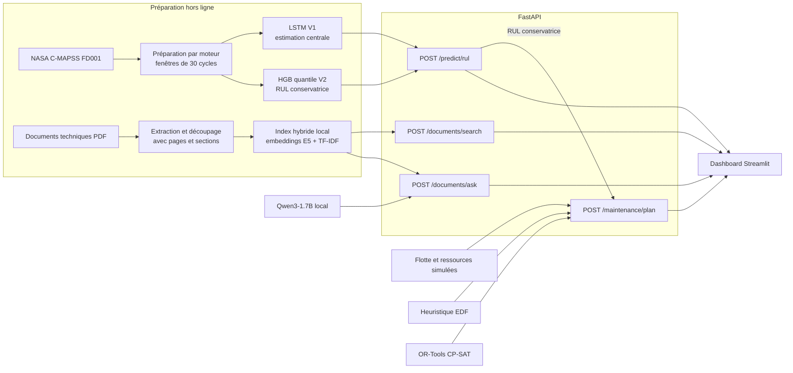

# Architecture de la plateforme

Cette architecture sépare l'entraînement, les services métier et l'interface. Les modèles et les index sont construits hors ligne, puis chargés par FastAPI pour l'inférence. Streamlit ne contient aucune logique de modèle : il consomme uniquement les routes HTTP.

## Chaîne RUL

Le pipeline transforme chaque historique moteur en une fenêtre multivariée de 30 cycles et 15 capteurs. Le LSTM V1 fournit une estimation centrale. Le HistGradientBoosting quantile V2 fournit une valeur volontairement prudente, calibrée avec une marge de sécurité. Les deux sorties viennent de modèles indépendants et ne forment pas un intervalle de confiance.

Les artefacts sérialisés contiennent le prétraitement, l'ordre des capteurs, les modèles et leurs empreintes. L'API vérifie ces éléments au démarrage et n'entraîne aucun modèle pendant une requête.

## Chaîne documentaire

Les documents sont extraits avec leurs métadonnées de provenance, puis découpés en passages. La recherche combine similarité dense et TF-IDF. Le générateur local reçoit uniquement les passages récupérés, produit des références vérifiables et s'abstient lorsque les preuves sont insuffisantes.

## Chaîne de planification

La RUL conservatrice devient l'échéance d'un équipement dans un scénario simulé. Le planificateur applique les capacités de l'atelier et des techniciens, puis compare une heuristique par échéance à CP-SAT. L'échéance porte sur la fin de l'intervention. Le coût agrège maintenance préventive, immobilisation, avance et retard pondéré par la criticité.

Les durées, ressources, criticités et coûts ne proviennent pas de C-MAPSS. Ils sont explicitement fournis par les scénarios afin de ne pas confondre démonstration d'optimisation et résultat économique industriel.

## Interfaces et déploiement

FastAPI constitue le contrat unique pour la prédiction, le RAG et la planification. Le dashboard Streamlit prépare les requêtes et rend les résultats lisibles. Le `Dockerfile` et `compose.yaml` décrivent deux conteneurs, un pour l'API et un pour l'interface. Cette configuration reste à exécuter sur une machine disposant de Docker Desktop.

## Artefacts principaux

| Composant | Entrée | Sortie persistée |
| --- | --- | --- |
| Préparation FD001 | séries C-MAPSS brutes | tableaux préparés, prétraitement et rapports |
| Modèles RUL | fenêtres de 30 cycles | bundles V1 et V2 avec manifestes et empreintes |
| Index documentaire | corpus PDF gelé | passages, embeddings, index lexical et manifeste |
| Évaluation | prédictions et jeux de questions | CSV, JSON, Markdown et figures |
| Planification | flotte et capacités simulées | plannings comparés, coûts, retards et diagrammes |

