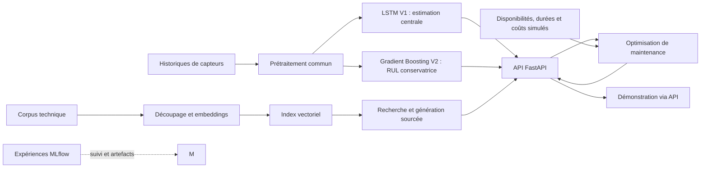

# Cahier des charges — Industrial AI Maintenance Platform

Date : 8 septembre 2026. Mise à jour : 9 octobre 2026. Statut : pipeline RUL, modèle conservateur V2, RAG sourcé, planification CP-SAT, API et dashboard exécutés localement ; validation du conteneur à poursuivre faute de Docker Desktop.

## Objectif et contexte

Construire un projet de portfolio pour un diplômé de master 2 en data science. Le dépôt doit montrer la capacité à formuler un problème, comparer des modèles, mesurer leurs limites et intégrer leurs sorties dans un service utilisable.

Environnement retenu : développement sur PC local ; Google Colab reste disponible en complément. La préparation, les entraînements ML/DL, l'API FastAPI et le dashboard fonctionnent sous Windows avec Python 3.12.10 dans `.venv`. Docker Desktop n'est pas installé sur le poste actuel ; les fichiers de conteneurisation sont donc fournis mais leur exécution reste à valider. Aucun délai de livraison n'a été fixé. Les [commandes de reproduction](../README.md#reproduire-les-jalons-1-à-5-sous-windows) couvrent l'installation, la préparation, l'entraînement, les évaluations, les services et les tests.

## Correspondance avec le sujet

| Exigence | Réalisation proposée pour la V1 | Preuve attendue |
| --- | --- | --- |
| Pipeline RUL et comparaison ML/DL | Préparation de C-MAPSS FD001, référence naïve, Random Forest et LSTM | Réalisé : sélection sur validation interne, réentraînement sur tout le train et bilan sur le test officiel |
| RAG sur documentation technique | Ingestion, découpage, embeddings, recherche vectorielle et génération avec références | Jeu de questions d'évaluation, passages retrouvés et réponses vérifiées |
| API FastAPI et planification | Double prédiction RUL, recherche, question-réponse et optimisation sous contraintes réalisées | Routes testées ; heuristique comparée à CP-SAT sur trois scénarios simulés |
| Docker, tests et reproductibilité | Configuration versionnée, suivi MLflow, tests ciblés, Dockerfile et service Compose | Tests locaux réalisés ; exécution du conteneur à valider dans un environnement Docker |

## Cas d'usage

Un utilisateur sélectionne l'historique de mesures d'un moteur. Le service estime sa durée de vie restante, puis permet de consulter des documents pertinents. À l'échelle d'une flotte simulée, un module distinct planifie des interventions selon les échéances estimées et les ressources disponibles.

La démonstration doit distinguer trois sorties : pronostic statistique, réponse documentaire et décision issue d'un modèle d'optimisation. Une estimation de RUL ne permet pas, à elle seule, d'identifier la cause d'une panne ou de prescrire une réparation.

## Architecture proposée

Organisation retenue : un dépôt Python avec des modules séparés pour les données, les modèles, le RAG, la planification et l'API. Un notebook sert à l'exploration ; les traitements reproductibles résident dans des modules et commandes réutilisables.

## 1. Données et prédiction de durée de vie restante

### Données retenues

Point de départ proposé : **NASA C-MAPSS, sous-ensemble FD001**. Il contient des séries multivariées simulées de moteurs, avec 100 trajectoires d'entraînement et 100 de test, une condition opératoire et un mode de dégradation. L'entraînement suit les moteurs jusqu'à leur fin de vie ; le test s'arrête avant celle-ci et fournit les RUL restantes. L'unité de prédiction est le cycle opérationnel. [Description officielle](https://catalog.data.gov/dataset/cmapss-jet-engine-simulated-data).

La [page NASA PCoE, rubrique 6](https://www.nasa.gov/intelligent-systems-division/discovery-and-systems-health/pcoe/pcoe-data-set-repository/) référence une archive de téléchargement. Les fichiers ont maintenant été fournis localement dans `CMAPSSData/` et leur structure a été contrôlée. Les comptages et empreintes figurent dans le [rapport d'audit](../reports/DATASET_AUDIT.md) ; l'URL exacte de la copie téléchargée reste à renseigner.

Conserver les fichiers bruts, leur provenance et leur empreinte SHA-256. Vérifier le schéma des colonnes, les identifiants, l'ordre des cycles, les doublons et les valeurs manquantes. Réserver FD002–FD004 à une extension après validation de la chaîne complète sur FD001.

### Cible et préparation

Pour un moteur d'entraînement : `RUL(t) = cycle_final - t`.

Pour une trajectoire de test, le dernier cycle observé n'est pas le cycle de panne. Évaluer sa dernière prédiction avec la RUL fournie dans le fichier officiel, en vérifiant l'association aux identifiants des moteurs.

Décisions implémentées au jalon 1 :

- Séparer les 100 moteurs de `train_FD001.txt` en 80 moteurs d'apprentissage et 20 de validation avec la graine 42, avant tout ajustement du prétraitement ou fabrication de fenêtres ; enregistrer leurs identifiants.
- Conserver 15 capteurs après retrait des six constantes exactes détectées sur l'apprentissage. Ajuster `StandardScaler` sur ce seul groupe et sérialiser le prétraitement. Les valeurs manquantes ou non finies sont rejetées ; aucune imputation n'est appliquée. Les réglages et le cycle ne sont pas des caractéristiques dans cette première configuration FD001.
- Utiliser des fenêtres causales : à l'instant t, aucune observation postérieure à t n'entre dans les caractéristiques. Une fenêtre appartient à un seul moteur.
- Partir d'une longueur de fenêtre de 30 cycles, modifiable par configuration pour de futures expériences sur validation. Produire une fenêtre par observation d'apprentissage et une seule fenêtre finale par moteur de validation tronqué.
- Compléter les historiques courts à gauche en répétant leur première observation ; enregistrer leur longueur réellement observée. Cette politique sera reprise à l'inférence.
- Utiliser la RUL non plafonnée, calculée avant toute troncature. Un plafonnement éventuel sera une expérience distincte, explicitement documentée, avec maintien d'un rapport sur la cible brute.

La validation utilise une coupure fixée par moteur avec la graine 43, tirée uniformément entre `min(20, T - 1)` et `T - 1`, où `T` est le cycle de fin de vie. La connaissance de `T` sert à construire le protocole rétrospectif et les cibles ; elle n'est pas une entrée du modèle. Cette validation simulée ne garantit pas la même distribution que le test officiel.

Les sorties exécutées comptent 16 779 observations d'apprentissage et 2 037 observations de validation après troncature, contre 3 852 avant troncature. Les tableaux d'entrée ont les formes `(16779, 30, 15)` et `(20, 30, 15)`. Le [rapport de préparation](../reports/fd001/PREPARATION_FD001.md), la [configuration](../configs/fd001.toml), le [notebook exécuté](../notebooks/01_fd001_exploration.ipynb) et le [dictionnaire des données](DICTIONNAIRE_DONNEES.md) documentent ces choix. La préparation ne charge ni `test_FD001.txt` ni `RUL_FD001.txt`.

### Modèles et comparaison

Le jalon 2 a entraîné et comparé les modèles suivants sur les mêmes 20 moteurs de validation, sans lire le test officiel.

| Modèle | Entrée | Rôle |
| --- | --- | --- |
| Référence constante | Moyenne pondérée des cibles d'apprentissage | Vérifier l'intérêt des modèles appris |
| Random Forest | Dernières valeurs et statistiques de la fenêtre : moyenne, dispersion, tendance | Meilleur candidat : profondeur 12, feuilles d'au moins 5 exemples |
| LSTM compact avec PyTorch | Séquence multivariée de la même fenêtre | Modèle sélectionné sur la validation |

L'apprentissage des modèles utilise 15 179 fenêtres admissibles, terminées à partir du cycle 20 et strictement avant la panne. Chaque moteur possède le même poids total, afin que les trajectoires longues ne dominent pas l'objectif. Les entrées conservent 15 capteurs et 30 cycles ; `observed_lengths` permet d'ignorer le remplissage des historiques courts. La validation produit une prédiction par moteur.

| Modèle | MAE de validation | RMSE de validation |
| --- | ---: | ---: |
| Référence constante pondérée | 36,387 | 46,684 |
| Random Forest `depth12_leaf5` | 22,836 | 30,970 |
| LSTM compact | **18,378** | **23,196** |

Le LSTM atteint sa meilleure époque à l'époque 6 et l'entraînement s'arrête après 13 époques. Son biais moyen `prédiction - RUL réelle` vaut +6,801 cycles, son erreur absolue au 90e percentile 35,392 cycles, son taux de surestimation 65 % et son score NASA 342,950. Le [rapport de comparaison](../reports/fd001/models/MODEL_COMPARISON.md), le [CSV des métriques](../reports/fd001/models/comparison.csv), les [prédictions par moteur](../reports/fd001/models/validation_predictions.csv) et les [figures](../reports/fd001/models/figures/) rendent ces résultats vérifiables.

Le gain de RMSE du LSTM sur le meilleur Random Forest est de 7,774 cycles, soit 25,1 %. Il justifie la sélection provisoire du LSTM, sous les limites de validation décrites ci-dessous.

La [configuration du jalon 2](../configs/fd001_models.toml) fixe les candidats, la graine et les règles d'apprentissage. La commande `train-fd001` enregistre les expériences dans une base MLflow SQLite locale, avec ses artefacts dans un répertoire séparé. Le rapport et les CSV restent versionnables indépendamment de ce stockage local.

### Évaluation et critères de qualité

- Métriques de sélection : MAE et RMSE en cycles, sur une prédiction à la dernière observation de chaque moteur de validation. Le biais, le 90e percentile de l'erreur absolue, le taux de surestimation et le score NASA complètent l'analyse.
- Le LSTM est sélectionné sur validation ; le test officiel est ouvert une seule fois pour le bilan final après gel du protocole.
- Construire une validation avec des trajectoires tronquées de façon prédéfinie, afin de simuler des observations avant panne ; utiliser la fin de vie connue uniquement pour calculer la cible.
- Examiner les surestimations de RUL, les erreurs selon la durée restante et les moteurs les moins bien prédits.
- Répéter les entraînements stochastiques finaux, par exemple sur trois graines, si le budget le permet.
- Mesurer temps d'entraînement, latence et taille des modèles pour éclairer le choix de déploiement.
- Distinguer variabilité des scores entre exécutions et incertitude sur une prédiction individuelle. Une RUL ponctuelle n'est pas une probabilité de panne.

La validation ne contient que 20 moteurs, avec une seule coupure par moteur ; trois seulement ont une RUL inférieure ou égale à 30 cycles. La RMSE de 23,196 cycles est donc un résultat de sélection, pas un score final ni une preuve de performance près de la panne. Les performances sur FD001 ne constituent pas une validation sur d'autres équipements ou conditions opératoires.

### Bilan officiel FD001

Le choix du LSTM, ses hyperparamètres et la durée de six époques ont été gelés à partir de la validation. Le prétraitement et le modèle ont ensuite été réentraînés sur les 100 moteurs complets de `train_FD001.txt`, avec 18 631 fenêtres admissibles. Le fichier `RUL_FD001.txt` n'intervient ni dans cet apprentissage ni dans les choix du modèle ; il sert uniquement à mesurer les 100 prédictions finales produites depuis `test_FD001.txt`.

| Métrique sur le test officiel | Valeur |
| --- | ---: |
| MAE | **14,233 cycles** |
| RMSE | **20,986 cycles** |
| Biais moyen, prédiction − réalité | +7,850 cycles |
| Erreur absolue au 90e percentile | 36,439 cycles |
| Taux de surestimation | 73 % |
| Score NASA, somme sur 100 moteurs | 14 432,738 |

Le [rapport final](../reports/fd001/test/OFFICIAL_TEST_EVALUATION.md), les [prédictions par moteur](../reports/fd001/test/official_test_predictions.csv), la [configuration](../configs/fd001_final.toml) et le [résumé avec empreintes](../reports/fd001/test/official_test_summary.json) documentent l'exécution. Le modèle est meilleur sur les faibles RUL que sur plusieurs trajectoires encore éloignées de la panne. Son biais positif, ses 73 % de surestimations et une erreur maximale de +94,675 cycles imposent de présenter la prédiction comme une estimation imparfaite. Une future version devra être réglée avec un nouveau protocole de validation, sans réutiliser ces cibles de test pour sélectionner ses choix.

### Objectif asymétrique et modèle conservateur V2

La V1 optimisait principalement la RMSE, alors que le cas d'usage accorde un coût plus élevé à une RUL surestimée : elle peut retarder une intervention. La V2 fixe avant sélection un coût de surestimation égal à cinq fois celui d'une sous-estimation, une limite globale de 20 %, une limite de 20 % dans chaque pli et une limite de 25 % à chaque horizon évalué. Prédire systématiquement zéro ne constitue pas une solution acceptable ; MAE, RMSE, biais et coût asymétrique restent donc rapportés.

Le protocole utilise uniquement `train_FD001.txt`, réparti en cinq plis de moteurs. Le prétraitement est réajusté dans chaque pli et les modèles sont évalués aux RUL 5, 10, 20, 30, 50, 75, 100, 125 et 150. Le Random Forest MSE est comparé à cinq quantiles lors d'une première passe, puis aux quantiles 0,05, 0,075 et 0,10 lors de la recherche ciblée. La marge de sécurité d'un pli est calculée uniquement avec les erreurs hors pli des quatre autres plis.

Le bundle retenu associe un HistGradientBoosting au quantile 0,05 et une marge de 3,969 cycles, selon `max(prédiction - marge, 0)`. Sur les prédictions hors pli, il obtient une MAE de 20,029 cycles, une RMSE de 29,220, un biais de −19,573, 5,1 % de surestimations, 0,5 % de surestimations supérieures à 10 cycles et une surestimation maximale de 18,374 cycles. Le pire pli atteint 10,4 % et le pire horizon 15,9 %, donc les trois contraintes empiriques sont respectées.

Ces résultats décrivent une RUL conservatrice pour la décision, pas une estimation centrale ni une garantie de couverture future. La sous-estimation moyenne implique un coût opérationnel potentiel par maintenance anticipée. Le [rapport de sélection](../reports/fd001/safety_v2/SAFETY_SELECTION.md), le [rapport de calibration](../reports/fd001/safety_v2/SAFETY_CALIBRATION.md), la [configuration de sélection](../configs/fd001_safety_v2.toml), la [configuration de calibration](../configs/fd001_safety_calibration.toml) et les prédictions hors pli conservent les preuves. Le test officiel FD001, déjà consulté pour la V1, n'a servi ni à choisir les quantiles ni à calibrer la marge.

## 2. RAG documentaire

### Corpus

Le corpus v1 regroupe cinq documents techniques publics. Le manifeste enregistre pour chacun le titre, l'origine, la version ou date, les pages retenues, l'empreinte SHA-256 et la réserve d'usage.

La documentation du jeu de données et les rapports scientifiques décrivent la simulation ; ils ne remplacent pas un manuel de maintenance constructeur. Si des fiches pédagogiques sont créées pour la démonstration, les identifier explicitement comme synthétiques dans les métadonnées et les réponses.

### Chaîne réalisée

1. Extraire le texte en conservant les références document/page ou section.
2. Découper selon les sections avec un chevauchement contrôlé.
3. Encoder documents et questions avec un modèle adapté à leur langue et à la recherche question-vers-passage.
4. Rechercher les passages avec une similarité cosinus dense et un score TF-IDF, puis fusionner leurs rangs.
5. Transmettre les passages à un modèle génératif et produire une réponse référencée.
6. Répondre explicitement que le corpus ne suffit pas lorsque les éléments disponibles ne permettent pas de répondre.

L'encodeur `multilingual-e5-small` et Qwen3-1.7B sont chargés localement à des révisions figées. Les 192 passages, leurs embeddings normalisés et l'index lexical sont enregistrés avec leurs manifestes. Aucun service distant ou payant n'est nécessaire. La [documentation Sentence Transformers](https://sbert.net/examples/sentence_transformer/applications/semantic-search/README.html) décrit le principe de recherche par embeddings utilisé ici.

### Évaluation

Le jeu de développement contient 30 questions avec réponses ou passages attendus : 25 sont couvertes et cinq doivent conduire à une abstention.

La bonne référence document-page apparaît dans le top 5 pour 25 questions couvertes sur 25. La génération obtient 30 décisions répondre ou s'abstenir correctes sur 30, cite les 25 références attendues et atteint une similarité moyenne de 0,915. Comme ce jeu a servi aux réglages, une future évaluation indépendante devra mesurer la généralisation.

Traiter le contenu des documents comme des données, y compris lorsqu'il contient des instructions adressées à un assistant. Prévoir un test de ce comportement. Versionner le corpus, le découpage, les modèles et le prompt avec l'index.

## 3. Planification de maintenance

Les disponibilités des techniciens, durées d'intervention et coûts ne sont pas déduits des seules séries C-MAPSS. Trois scénarios de flotte explicitement simulés et versionnés couvrent une charge normale, une charge contrainte et un cas irréalisable.

Les entrées sont la RUL conservatrice, la criticité, la durée d'intervention, le besoin en techniciens, l'horizon, la capacité de l'atelier et celle de l'équipe. Le dashboard peut injecter la RUL conservatrice courante dans la flotte éditable.

L'échéance est la partie entière de la RUL conservatrice et reste exprimée en cycles. La conversion en jours n'est pas effectuée, car elle demanderait un rythme d'utilisation métier absent de C-MAPSS.

La formulation affecte les interventions obligatoires à des créneaux, limite simultanément les places d'atelier et les techniciens, et applique l'échéance à la fin de l'intervention. Elle minimise maintenance préventive, immobilisation, avance et retard pondéré par la criticité.

Le solveur OR-Tools CP-SAT utilise des variables d'intervalle et des contraintes cumulatives. [Exemple officiel d'ordonnancement OR-Tools](https://developers.google.com/optimization/scheduling/job_shop).

Le solveur est comparé à une heuristique qui traite d'abord les échéances proches, avec les mêmes contraintes et la même fonction de coût. Sur le scénario contraint, CP-SAT prouve un optimum de 5 110 unités contre 7 680 pour l'heuristique et réduit le retard cumulé de cinq à deux cycles.

Le statut distingue une solution réalisable d'un optimum prouvé et signale les scénarios impossibles. Tous les gains sont décrits comme des résultats sur scénarios simulés et non comme des économies industrielles observées.

## 4. API et reproductibilité

La première tranche de l'API est réalisée avec FastAPI. La validation Pydantic des entrées, les schémas de réponse et la documentation interactive facilitent la démonstration. [Documentation officielle](https://fastapi.tiangolo.com/).

| Route | État | Fonction et informations essentielles |
| --- | --- | --- |
| `GET /health` | Réalisée | Disponibilité de l'inférence, version de l'API et versions des deux modèles |
| `GET /models` | Réalisée | Fenêtre, capteurs requis, rôle, protocole d'évaluation et métriques des deux modèles |
| `POST /predict/rul` | Réalisée | Double prédiction depuis un historique brut ordonné, marge, cycles utilisés et versions |
| `GET /docs` | Réalisée | Documentation OpenAPI interactive |
| `POST /documents/search` | Réalisée | Extraits, scores et références |
| `POST /documents/ask` | Réalisée | Réponse, sources et abstention éventuelle |
| `POST /maintenance/plan` | Réalisée | Heuristique, planning CP-SAT, coût, retards et statut du solveur |

Le contrat de `POST /predict/rul` accepte un `unit_id` entier positif et au plus 1 000 observations d'un même moteur. Chaque observation porte un cycle positif et les 15 capteurs variables retenus par FD001. Les six capteurs constants peuvent être fournis mais sont ignorés ; les réglages opératoires, la cible RUL et les champs inconnus sont refusés. Les nombres doivent être finis et les cycles strictement consécutifs, ordonnés et sans doublon. Le dernier cycle doit être au moins égal à 20, seuil appliqué pendant l'apprentissage. Un historique de 20 à 29 cycles doit donc commencer au cycle 1 ; il est complété à gauche en répétant sa première observation. Pour un historique plus long, la fenêtre finale de 30 cycles alimente les deux modèles. Les requêtes terminées avant le cycle 20 sont rejetées afin de ne pas exposer une extrapolation insuffisamment étayée.

La réponse retourne `unit_id`, `history_start_cycle`, `last_cycle`, `observed_cycles`, `window_cycles_used`, `unit` et deux versions d'artefacts. `rul_estimate` est la sortie ponctuelle du LSTM V1. `safety_base_prediction` est produite séparément par le HistGradientBoosting quantile V2 ; `rul_conservative` applique ensuite la règle `max(safety_base_prediction - safety_margin, 0)`. `decision_value` reprend cette dernière valeur pour le planificateur. La marge V2 de 3,969 cycles n'est donc pas soustraite au LSTM. Les deux sorties ne bornent pas un intervalle de confiance et ne donnent pas une probabilité de panne.

Le prétraitement, l'ordre des capteurs et les transformations sont sérialisés avec chaque modèle et réutilisés à l'inférence. Au démarrage, le service recharge les bundles sur CPU, vérifie les empreintes SHA-256 ainsi que la cohérence des manifestes, puis garde les modèles en mémoire. Une incohérence de requête produit une réponse `422` ; un bundle absent, modifié ou incohérent rend les routes d'inférence indisponibles avec une réponse `503`. La [configuration](../configs/api.toml), le [module d'API](../src/industrial_maintenance/api.py), le [pipeline d'inférence](../src/industrial_maintenance/inference.py), le [rapport de validation](../reports/fd001/api/API_VALIDATION.md) et les [commandes PowerShell](../README.md#api-dinférence-rul) documentent cette tranche.

La V1 et la V2 répondent à deux objectifs différents. La première conserve la meilleure estimation centrale mesurée sur le test officiel, tout en surestimant la RUL de 73 % des moteurs de ce test. La seconde sert aux décisions sensibles au retard : elle atteint 5,1 % de surestimations hors pli, avec un biais de −19,573 cycles. Ce taux est une mesure empirique sur la validation croisée FD001 et ne garantit pas le même comportement sur un futur équipement. Les valeurs restent des cycles simulés C-MAPSS, sans conversion implicite en temps calendaire et sans diagnostic de cause de panne.

Le jalon 2 suit déjà avec MLflow les paramètres, métriques et artefacts des expériences dans `mlruns/mlflow.db`, avec les artefacts locaux dans `mlruns/artifacts/`. [Documentation MLflow Tracking](https://mlflow.org/docs/latest/ml/tracking/). L'évaluation officielle possède une expérience MLflow séparée. Les empreintes des données et du code, les versions des dépendances et les artefacts rechargeables sur CPU sont enregistrés dans les résumés d'expérience. Cette convention sera réutilisée pour les étapes suivantes.

La commande `serve-maintenance-api --config configs/api.toml` lance le service local avec Uvicorn. Le [Dockerfile](../Dockerfile) installe les dépendances d'inférence et d'interface, puis embarque les deux bundles figés et la trajectoire de démonstration sans cible RUL. [Compose](../compose.yaml) publie l'API sur le port 8000 et le dashboard sur le port 8501, avec un contrôle de santé pour chaque service. La construction se lance avec `docker compose up --build` et reste à exécuter sur une machine où Docker Desktop est disponible. Les conteneurs rechargent des artefacts préparés sans acquérir les données ni entraîner les modèles ; les commandes d'acquisition, d'entraînement et d'indexation restent séparées et explicites.

Les tests couvrent le rechargement et les empreintes des artefacts, la transformation d'un historique, la cohérence entre appel local et appel HTTP, les schémas de réponse, les entrées incorrectes, les références RAG, l'abstention, le respect des contraintes de planning et les scénarios irréalisables. Ils utilisent de petits artefacts de test et ne nécessitent ni serveur lancé séparément, ni service LLM distant, ni téléchargement complet des données.

## Périmètre après la V1

Extensions à choisir à partir des résultats : conditions opératoires multiples sur FD002/FD004, boosting, CNN temporel, intervalles prédictifs calibrés, recherche hybride avec reclassement et optimisation tenant compte de l'incertitude.

La chaîne locale est exécutable, évaluée et documentée. Le score officiel FD001, les résultats RAG de développement et les gains de planification simulés sont établis. La validation du déploiement conteneurisé reste à effectuer sur une machine équipée de Docker Desktop.

## Interface utilisateur de démonstration

L’application fournit un dashboard Streamlit qui consomme exclusivement l’API FastAPI par HTTP. Son objectif est de rendre le pipeline de prédiction compréhensible et testable sans demander à l’utilisateur de construire une requête JSON.

Le [rapport de validation du dashboard](../reports/fd001/ui/DASHBOARD_VALIDATION.md) conserve le lancement réel des deux services, l'interaction automatisée avec le bouton de prédiction, la réponse obtenue et les limites de cette démonstration.

Le parcours fonctionnel attendu est le suivant :

1. vérifier visuellement la disponibilité de l’API ;
2. choisir un moteur FD001 de démonstration ou importer un fichier CSV ;
3. sélectionner le moteur lorsque le fichier en contient plusieurs et choisir le cycle d’observation ;
4. consulter un aperçu des données et les courbes de capteurs ;
5. déclencher la prédiction ;
6. consulter la RUL conservatrice, la RUL centrale, l’échéance prudente exprimée en cycles et, sur demande, les détails des modèles.

L’interface doit conserver la séparation des responsabilités : elle prépare le payload et traduit les erreurs pour l’utilisateur, tandis que FastAPI reste responsable de la validation finale et de l’inférence. Les deux sorties proviennent de modèles distincts et ne doivent pas être présentées comme les bornes d’un intervalle de confiance.

Le service local est lancé avec `serve-maintenance-dashboard --api-url http://127.0.0.1:8000 --port 8501`, parallèlement à l’API sur le port 8000. En conteneur, Docker Compose expose `127.0.0.1:8000` pour l’API et `127.0.0.1:8501` pour le dashboard, lequel contacte le service `maintenance-api` sur le réseau interne. La configuration Docker reste non validée localement faute d’installation de Docker.

Cette version constitue une démonstration des pipelines ML, RAG et de planification. Le dashboard permet d'éditer une flotte simulée, d'injecter la RUL conservatrice courante et de comparer l'heuristique à CP-SAT. Les coûts et criticités restent hypothétiques ; la conversion en dates calendaires et la génération d'ordres de travail réels ne font pas partie du périmètre.

### Critères d’acceptation

- une prédiction de démonstration peut être obtenue sans écrire de JSON ;
- un CSV valide est transformé en une requête conforme au contrat FastAPI ;
- les données invalides et l’indisponibilité de l’API produisent un message compréhensible ;
- les courbes et les résultats correspondent au moteur et au cycle sélectionnés ;
- aucun code d’inférence, de modèle ou de prétraitement n’est dupliqué dans Streamlit.
