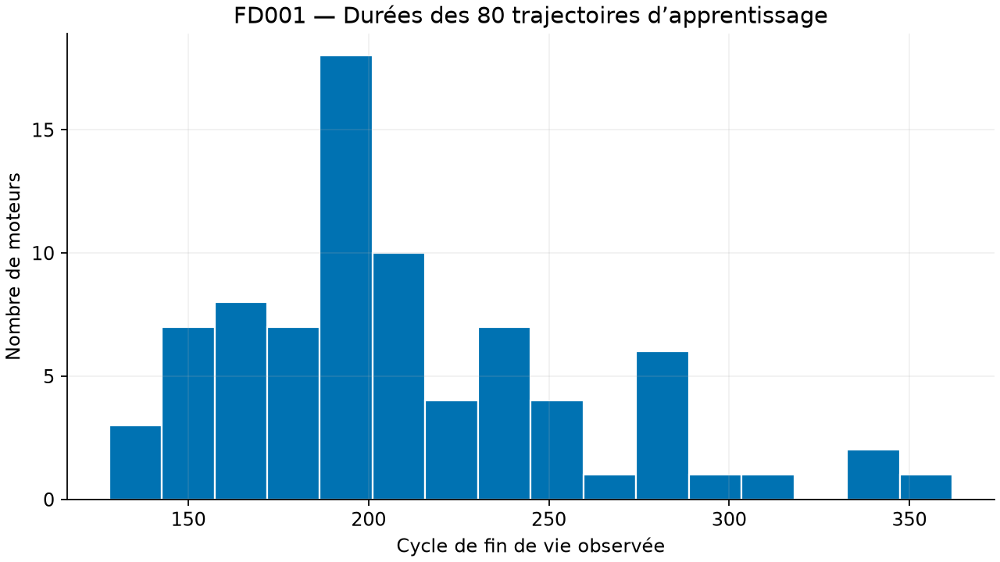
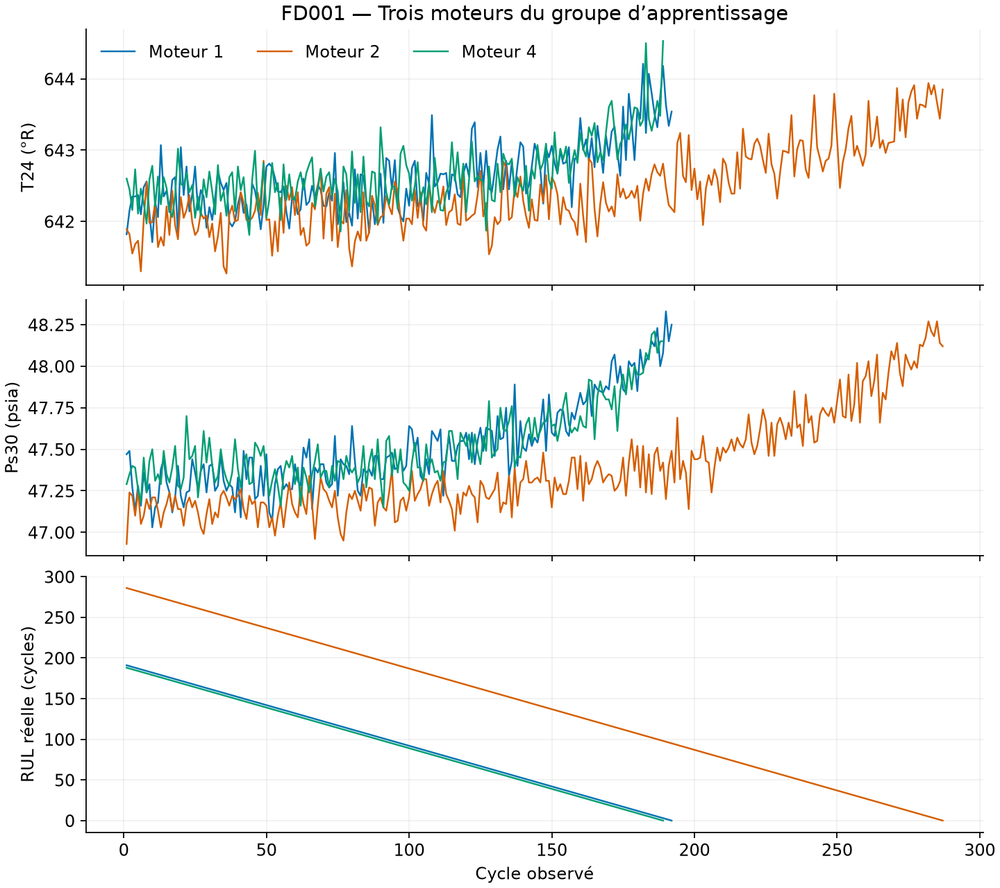

# FD001 — Préparation et exploration

Rapport produit par `python -m industrial_maintenance.prepare --config configs/fd001.toml`.
Il décrit exclusivement la préparation des données. La comparaison ML/DL exécutée ensuite est
documentée séparément dans [models/MODEL_COMPARISON.md](models/MODEL_COMPARISON.md).

## Séparation des moteurs

| Groupe | Moteurs | Observations |
| --- | ---: | ---: |
| Apprentissage | 80 | 16779 |
| Validation, historiques complets avant troncature | 20 | 3852 |
| Validation, historiques observables après troncature | 20 | 2037 |

Les identifiants des deux groupes sont disjoints et enregistrés dans [splits.json](splits.json).
La séparation utilise la graine 42 avant tout
ajustement du prétraitement. Seul `train_FD001.txt` a été ouvert pour cette préparation.
Les fichiers test et RUL officiels restent réservés au bilan final.

La RUL brute est calculée par moteur à partir de la fin de vie connue. Pour la validation,
un seul instant d'observation est tiré avant la fin de vie de chaque moteur, avec la graine
43. Les RUL calculées avant troncature sont conservées.
Les instants et les cibles figurent dans [validation_cutoffs.csv](validation_cutoffs.csv).
Ce protocole de validation simulée ne reproduit pas nécessairement la distribution du test officiel.

## Capteurs et prétraitement

Le prétraitement utilise les capteurs ; les réglages et l'âge sont conservés dans les CSV bruts
préparés mais ne sont pas des entrées dans cette première configuration FD001 à régime unique.
L'identifiant du moteur et la RUL ne sont jamais des caractéristiques d'entrée.

15 capteurs sont conservés. Les constantes exactes,
détectées sur les seuls moteurs d'apprentissage, sont retirées : `sensor_1`, `sensor_5`, `sensor_10`, `sensor_16`, `sensor_18`, `sensor_19`.
Les capteurs de faible variance restent présents à ce stade. Les statistiques de chaque
capteur figurent dans [learning_sensor_statistics.csv](learning_sensor_statistics.csv).
Ces variances brutes ne sont pas comparables physiquement entre grandeurs d'unités différentes.

Les moyennes et écarts-types sont ajustés sur l'apprentissage avec `StandardScaler` puis
réutilisés pour la validation. L'ordre des capteurs et les paramètres sont enregistrés
dans [preprocessing.json](preprocessing.json) ainsi que dans `preprocessor.joblib`.
Une validation normalisée n'a aucune raison d'avoir une moyenne exactement nulle.

## Fenêtres causales

- Apprentissage : `[16779, 30, 15]`, une fenêtre par observation.
- Validation : `[20, 30, 15]`, une dernière fenêtre par moteur tronqué.
- Longueur choisie : 30 cycles ; cibles non plafonnées, en cycles.
- Les historiques courts sont complétés à gauche par répétition de leur première observation.
  `observed_lengths` conserve le nombre réel d'observations présentes, distinct du remplissage.

Cette règle est identique pour les deux groupes et sera réutilisée à l'inférence. Elle ne crée
pas de nouveaux cycles réels. Les futures caractéristiques Random Forest devront être construites
sur la même fenêtre observable, en tenant compte de cette convention et des longueurs réelles.

## Exploration du groupe d'apprentissage

Les courbes de RUL sont des cibles reconstruites, pas des prédictions. Les mesures peuvent
fluctuer ; un capteur n'est pas tenu de suivre une évolution monotone avec la dégradation.

## Reproductibilité

Le [résumé structuré](preparation_summary.json) contient la configuration, le hash du fichier
source, les empreintes du code de préparation, les versions des bibliothèques et les empreintes
des artefacts. Le [snapshot Windows Python 3.12](../../requirements-lock-win-py312.txt) fige
les dépendances Python de cette exécution. Les identifiants, les coupures et les valeurs des
tableaux sont déterministes avec la configuration et les versions enregistrées. Le manifeste
JSON du prétraitement est lisible indépendamment de joblib.

Cette étape prépare la comparaison des modèles du jalon 2. Aucune performance de RUL
sur validation ou test n'est revendiquée dans ce rapport.
