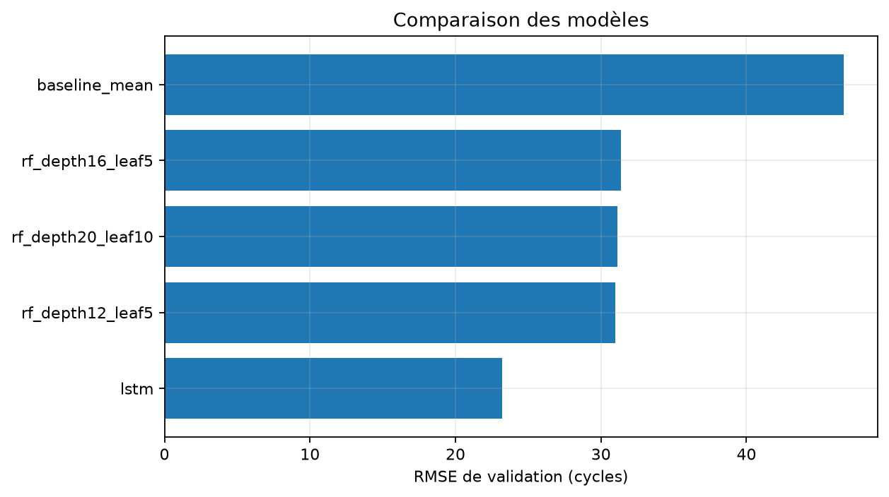
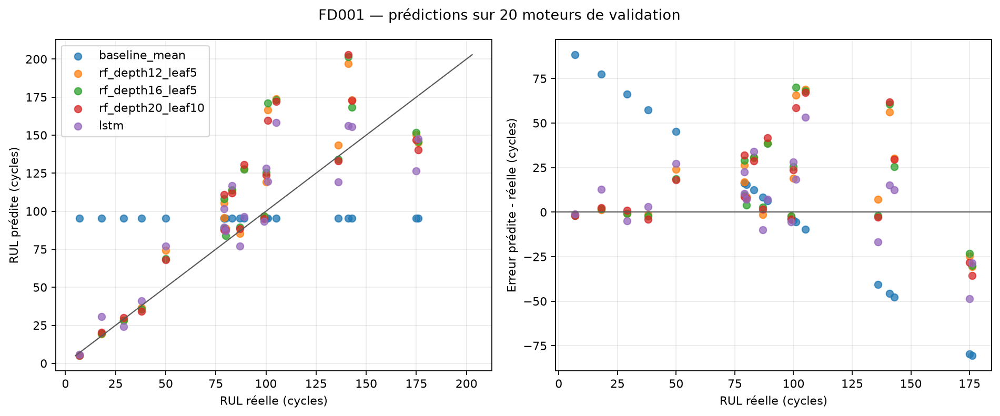
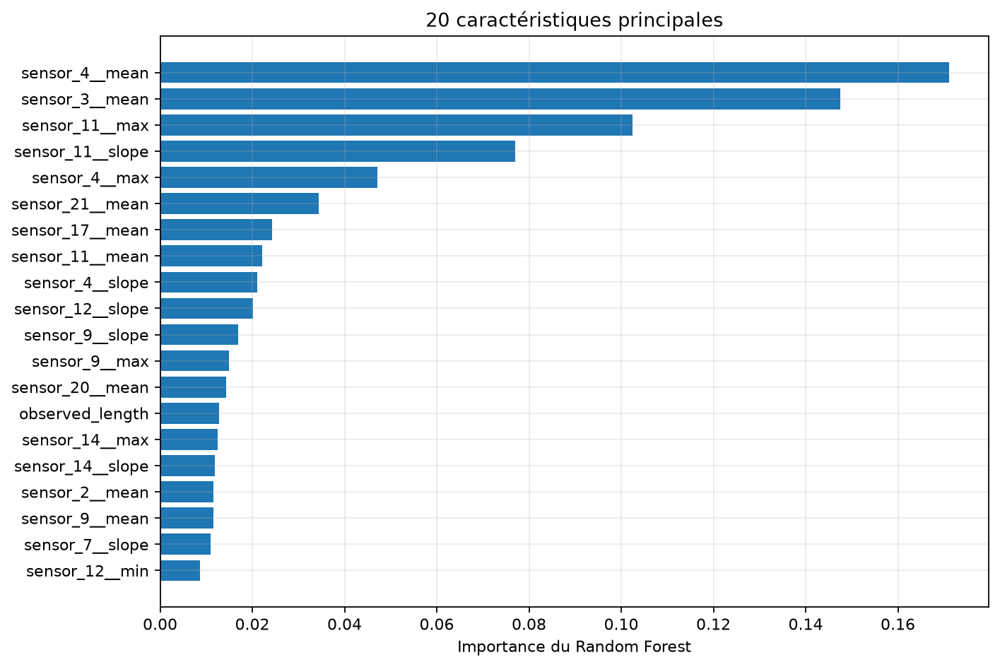
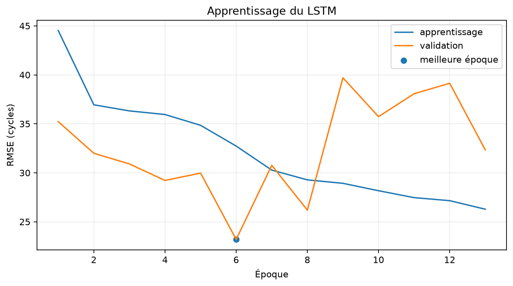

# FD001 — Comparaison des premiers modèles de RUL

Ce rapport présente uniquement les résultats sur la validation interne issue de
`train_FD001.txt`. Le test officiel et `RUL_FD001.txt` n'ont pas été lus.

## Protocole

- 80 moteurs d'apprentissage et 20 moteurs de validation disjoints.
- Fenêtres de 30 cycles et 15 capteurs, préparées au jalon 1.
- Apprentissage limité aux coupures de cycle >= 20 et strictement avant la panne.
- 15179 fenêtres admissibles ; chaque moteur possède le même poids total.
- Une dernière fenêtre par moteur de validation, soit 20 prédictions.
- Cible RUL brute, non plafonnée. Sélection principale par RMSE de validation.

## Résultats de validation

| Modèle | MAE | RMSE | Biais | Erreur absolue P90 | Surestimation | Score NASA |
| --- | ---: | ---: | ---: | ---: | ---: | ---: |
| lstm | 18.378 | 23.196 | 6.801 | 35.392 | 65.0 % | 342.950 |
| rf_depth12_leaf5 | 22.836 | 30.970 | 16.568 | 57.045 | 65.0 % | 2110.619 |
| rf_depth20_leaf10 | 23.001 | 31.149 | 15.324 | 58.919 | 70.0 % | 1827.664 |
| rf_depth16_leaf5 | 22.357 | 31.370 | 16.059 | 61.280 | 65.0 % | 2538.142 |
| baseline_mean | 36.387 | 46.684 | 4.619 | 79.731 | 55.0 % | 11396.449 |

Le modèle sélectionné sur ce protocole est **lstm**, avec une RMSE de
**23.196 cycles** et une MAE de **18.378 cycles**.

## Modèles

La référence constante prédit la moyenne pondérée des cibles admissibles. Le Random Forest
utilise sept statistiques causales par capteur — dernière valeur, moyenne, écart-type,
minimum, maximum, différence et pente — plus la longueur réellement observée. Les statistiques
ignorent le remplissage à gauche.

Le LSTM compact utilise directement les séquences `30 × 15`. Sa cible est standardisée à partir
de l'apprentissage pondéré puis reconvertie en cycles. L'arrêt anticipé a restauré l'époque
6 sur 13 exécutées. Les longueurs réellement observées sont
fournies au réseau afin que le remplissage à gauche des historiques courts soit ignoré.

## Lecture et limites

Ces chiffres servent à choisir un modèle dans le protocole actuel. La validation ne contient que
20 moteurs et une coupure aléatoire fixée par moteur ; l'incertitude autour des métriques reste
donc importante. Les fenêtres d'un même moteur se chevauchent, mais aucun moteur n'est partagé
entre apprentissage et validation. La RUL brute est difficile à estimer loin de la panne lorsque
les capteurs décrivent peu l'âge initial.

Les fichiers [comparison.csv](comparison.csv), [validation_predictions.csv](validation_predictions.csv)
et [experiment_summary.json](experiment_summary.json) permettent de vérifier les valeurs. Les
artefacts rechargeables sont enregistrés hors Git dans `artifacts/models/FD001/`, et les runs
MLflow locaux dans une base SQLite sous `mlruns/`. Le manifeste du modèle sélectionné référence
aussi le préprocesseur, l'ordre des capteurs et la règle de fenêtrage nécessaires à l'inférence.

Le test officiel reste réservé au bilan final, après gel du protocole et du modèle.
