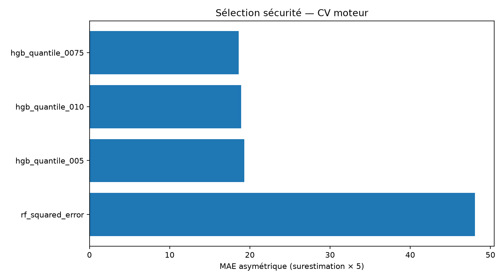
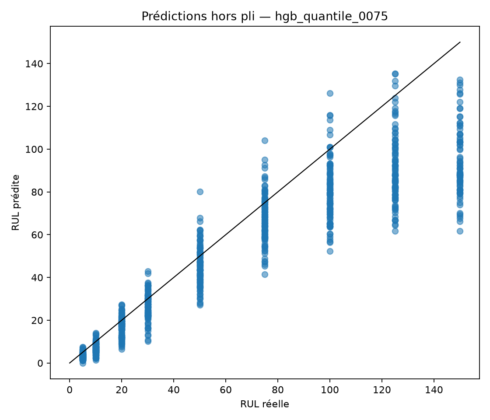

# FD001 — sélection orientée sécurité, version 2

Cette expérience n'ouvre ni `test_FD001.txt` ni `RUL_FD001.txt`. Elle corrige l'objectif de
sélection : une surestimation coûte 5.0 fois une
sous-estimation de même amplitude.

## Protocole

- Validation croisée à 5 plis, avec moteurs entièrement disjoints.
- Prétraitement réajusté dans chaque pli, sans information des moteurs évalués.
- Horizons déterministes : [5, 10, 20, 30, 50, 75, 100, 125, 150] cycles de RUL.
- Pondération donnant le même poids total à chaque moteur.
- Contrainte visée : au plus 20 % de surestimations.
- Une surestimation supérieure à 10 cycles est comptée séparément.

## Prédictions hors pli

| Modèle | MAE | RMSE | MAE asymétrique | Surestimation | Surestimation > marge | Maximum positif |
| --- | ---: | ---: | ---: | ---: | ---: | ---: |
| hgb_quantile_0075 | 15.018 | 23.689 | 18.614 | 17.8 % | 2.7 % | 30.085 |
| hgb_quantile_010 | 13.921 | 21.992 | 18.922 | 21.0 % | 4.0 % | 35.236 |
| hgb_quantile_005 | 16.901 | 26.676 | 19.322 | 16.0 % | 1.5 % | 22.327 |
| rf_squared_error | 12.317 | 18.718 | 48.087 | 66.4 % | 27.1 % | 76.248 |

Le modèle retenu est **hgb_quantile_0075**. Sa contrainte de surestimation est **respectée**.
Le modèle final est réentraîné sur les 100 moteurs de `train_FD001.txt`. Aucun nouveau score de
test officiel n'est calculé : les cibles officielles déjà consultées pour la V1 ne servent jamais
à choisir ou corriger cette V2.

