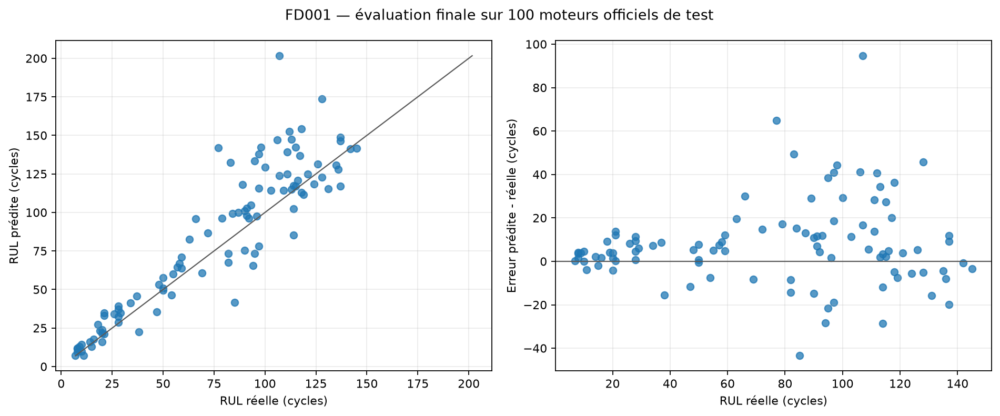

# FD001 — Évaluation finale sur le test officiel

Cette évaluation a été exécutée après gel du modèle sur la validation interne. Le test officiel
n'a servi ni à choisir l'architecture, ni à fixer les hyperparamètres, ni à déterminer le nombre
d'époques.

## Protocole final

- LSTM sélectionné sur la validation interne avec une RMSE de 23.196 cycles.
- Prétraitement réajusté sur les 100 moteurs complets de `train_FD001.txt`.
- 18631 fenêtres admissibles, avec poids total identique par moteur.
- Entraînement fixé à 6 époques, sans arrêt anticipé sur le test.
- Une dernière fenêtre de 30 cycles par moteur officiel de test.
- 100 cibles lues dans `RUL_FD001.txt`, alignées par identifiant de moteur.

## Résultat officiel

| MAE | RMSE | Biais | Erreur absolue P90 | Surestimation | Score NASA |
| ---: | ---: | ---: | ---: | ---: | ---: |
| 14.233 | 20.986 | 7.850 | 36.439 | 73.0 % | 14432.738 |

Les résultats détaillés se trouvent dans [official_test_predictions.csv](official_test_predictions.csv).
Ils constituent le bilan du modèle gelé. Toute amélioration ultérieure devra être conçue sur un
nouveau protocole de validation et présentée comme une nouvelle version, sans transformer ce test
en jeu de réglage.
